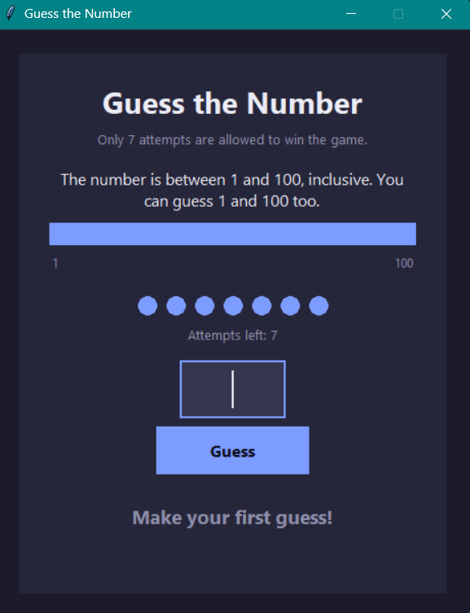

# Guess the Number

A number guessing game in Python. The computer picks a secret number from 1 to 100 and you have 7 attempts to find it. It comes in two versions: a console game and a desktop game with a graphical interface (Tkinter).



## Features

- 7 attempts to guess the secret number
- "Too low" / "Too high" hints after every guess
- A range bar that narrows to show where the number can still be
- Attempt dots that show how many tries are left
- Invalid input is rejected without costing an attempt
- Guess it in 3 attempts or fewer to be called a Genius
- Play again without restarting the program

## Requirements

- Python 3.8 or newer
- Tkinter (included with Python on Windows and macOS)
  - On Linux, if it is missing: `sudo apt install python3-tk`

## How to run

Clone the repository:

```bash
git clone https://github.com/GHubid123/guess-the-number.git
cd guess-the-number
```

Run the GUI version:

```bash
python Guess_the_number_gui.py
```

Run the console version:

```bash
python Guess_the_number.py
```

## How to play

1. Type a whole number from 1 to 100 and press **Enter** or click **Guess**.
2. Use the hint and the range bar to narrow down the secret number.
3. Find it within 7 attempts to win. Press **Play again** to start a new round.

## Project structure

| File | Description |
|------|-------------|
| `Guess_the_number.py` | Original console version |
| `Guess_the_number_gui.py` | Same game classes plus a Tkinter GUI |

## How it works

The game rules live in the `attempt` and `NumberGuessingGame` classes. The GUI version adds a small `GuiNumberGame` subclass that keeps the same rules but takes input from the window and stores messages instead of using `input()` and `print()`. `GameWindow` handles everything visual.

## Ideas for the future

- Web version so it can be played in a browser
- High score tracking
- Difficulty levels (different ranges and attempt limits)

## Author

Made by Harshita as a Python learning project.
